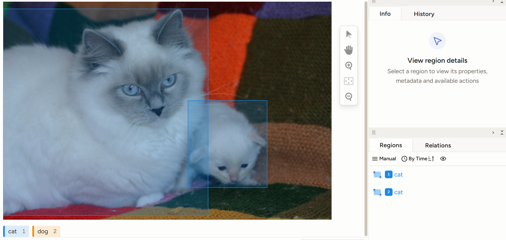
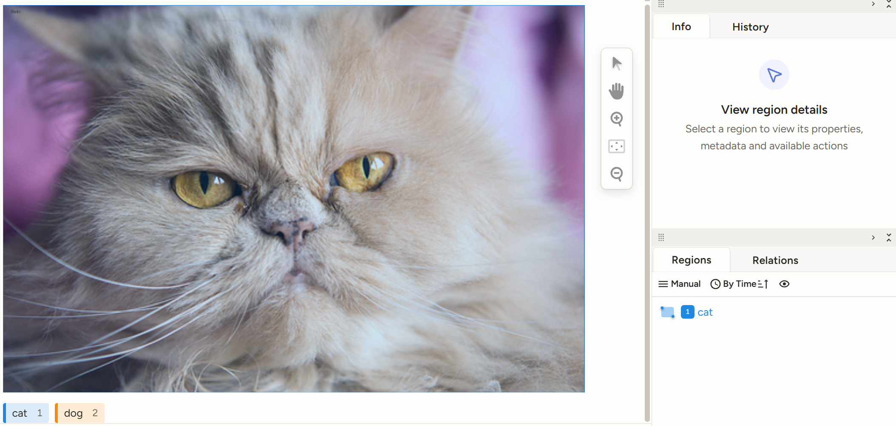
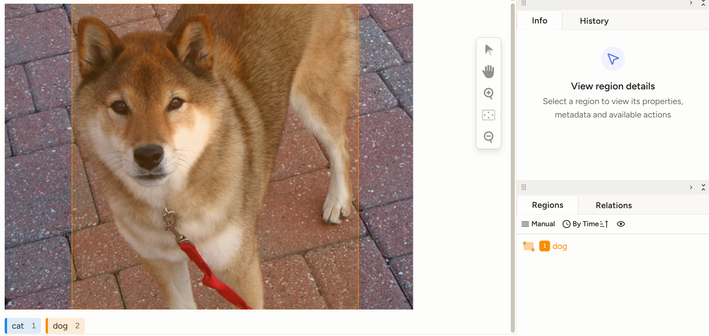
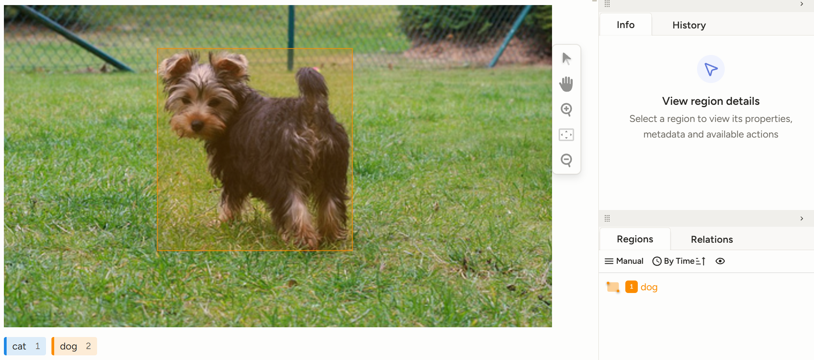

# Pet Detection Annotation (Cat vs Dog)

A bounding-box image annotation project built in **Label Studio**. I labeled a balanced subset of the Oxford-IIIT Pet Dataset under my own written guidelines, then ran a QA pass that combined automated checks with manual review.

## Summary

| Metric | Value |
|---|---|
| Images annotated | 150 (75 cat, 75 dog, randomly sampled) |
| Bounding boxes | 152 (77 cat, 75 dog) |
| Images with multiple animals | 2 |
| Total labeling time | ~115 minutes (Label Studio lead time) |
| Average time per image | ~46 seconds (~78 images/hour) |
| Label errors (automated check, 152 boxes) | 0 |
| Boxes corrected in manual review | 12 of 152 (7.9%), across 11 images |
| Guideline version | v1.1 |

## Task

- **Tool:** Label Studio (Object Detection with Bounding Boxes)
- **Classes:** `cat` (0), `dog` (1)
- **Source data:** [Oxford-IIIT Pet Dataset](https://www.robots.ox.ac.uk/~vgg/data/pets/) (images are not included in this repo, see the source link)
- **Export formats:** Label Studio JSON and YOLO

## Examples

| Overlapping animals | Close-up (animal fills frame) |
|---|---|
|  |  |
| **Truncated body, leash excluded** | **Standard case** |
|  |  |

## Annotation Guidelines (summary)

The full guidelines are in [`guidelines/annotation_guidelines_v1.1.pdf`](guidelines/).

- Draw a tight box around the full visible body, including the ears, tail and legs.
- **Fur:** include it and draw to the outer edge of the fur. **Whiskers:** exclude them.
- **Occluded:** box only the visible part. **Truncated:** box up to the image edge.
- **Multiple / overlapping animals:** give each animal its own box. Boxes may overlap.
- Skip animals smaller than ~20×20 px, toys, drawings and reflections.

**Change log**
- v1.0: initial guidelines
- v1.1: added rules for overlapping animals and for fur/whiskers, based on edge cases found while labeling

## Quality Assurance

**1. Automated checks** (`qa/qa_check.py`, run on the JSON export)

| Check | Result |
|---|---|
| Wrong label (each box compared with the class in its filename) | 0 errors |
| Missing box | 0 |
| Duplicate box (IoU > 70%) | 0 |
| Very small box (< 2% of image) | 0 |
| Near-full-image box (≥ 97% of image) | 14 flagged |

**2. Review of flagged boxes.** I opened each of the 14 flagged images. 13 were close-ups where the animal fills the frame, so those boxes were correct. One (a Pomeranian) had extra background and was tightened.

**3. Manual re-review against guideline v1.1.** After adding the fur/whisker and overlapping-animal rules, I re-checked all 150 images by eye. Automated checks cannot judge box tightness, so this pass caught issues they missed:

| Result | Count |
|---|---|
| Boxes corrected | 12 of 152 (7.9%) |
| Images corrected | 11 of 150 |
| Most common issue | Loose box (extra background), mostly on the top or right side |
| Box extended to whiskers (against v1.1) | 1 |
| Boxes accepted without change | 140 of 152 (92.1%) |

Every correction is listed in [`qa/qa_log.csv`](qa/).

## Repository Structure

```
pet-detection-annotation/
├── README.md
├── guidelines/
│   └── annotation_guidelines_v1.1.pdf
├── labels/
│   ├── json/          # Label Studio JSON export
│   └── yolo/          # YOLO labels + classes.txt
├── qa/
│   ├── qa_check.py
│   └── qa_log.csv
└── screenshots/       # sample labeled images
```

## What I Learned

- Writing the guideline before labeling saved time, and updating it as edge cases came up kept the labels consistent.
- Automated checks catch label and structure errors fast, but box tightness still needs human review: the manual pass found 12 loose boxes that no automated check flagged.
- When the guideline changes, earlier labels need to be re-checked against the new rules.
- The filename convention of the source dataset gives a free ground truth for checking class labels.
